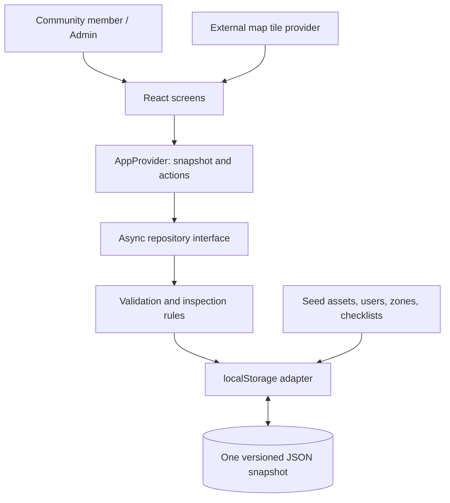

# Architecture — Green Assets

Status: planned browser-only MVP; no application implementation is included in this documentation package.

## System

One React application runs locally through Vite, executes business rules, and persists a small JSON dataset in the browser. No application server, SQL database, task queue, or HTTP business API is required.



## Responsibilities and proposed folders

```text
src/
  app/                 App shell, hash navigation, AppProvider
  components/          Shared inputs, badges, dialogs, empty/error states
  features/
    assets/            Map/list, asset details, admin form
    complaints/        Report form, complaint list
    jobs/              Job board, my jobs, inspection checklist
    dashboard/         Derived counts, due/hazard demo controls
  domain/
    types.ts           Canonical types from DATABASE.md
    rules.ts           Validation, job transitions, trigger deduplication
    checklists.ts      Versioned templates for three asset types
  services/
    repository.ts      Contract from API.md
    localRepository.ts Local implementation
  data/
    seed.ts            Fictional users, assets, zones, sample history
  lib/
    storage.ts         Versioned load/save/reset and storage error handling
    clock.ts           UTC timestamps and browser-local date helpers
```

React Context exposes the current snapshot, selected demo identity, and actions. A reducer handles snapshot replacement and loading/errors. Derived lists/counts come from this snapshot, not separate persisted counters.

Screens never access localStorage directly. Repository methods validate the actor and input, read the latest snapshot, apply all related changes, save once, and return a result. After a successful mutation, AppProvider reloads the snapshot. Serialize mutations in one repository instance to avoid overlapping actions in the presentation tab.

## What a snapshot means

A snapshot is one JavaScript object containing the application's current dataset: users, zones, assets, complaints, jobs, and hazard events. It is a data container, not a screenshot. `Snapshot` is the TypeScript name for that object's structure in DATABASE.md.

| Part | Purpose |
| --- | --- |
| Seed data | Starting example records, used only on first load or explicit reset |
| React state | The current in-memory dataset used to draw the screens |
| Saved snapshot | A JSON string in localStorage that restores the dataset after refresh |

On startup, read the saved JSON with `JSON.parse`, validate it, and put the resulting object into React state. If no data is saved yet, create and save the seed dataset instead.

For example, submitting a complaint adds a complaint record and creates or links an inspection job in the same object. Validate all changes, save the updated object using `JSON.stringify` and one localStorage write, then refresh React state from the saved result. Both the complaint list and job board now show the same data.

Each save replaces the previous saved snapshot. It does not create a historical backup; completed job records provide the inspection history inside the current dataset. `schemaVersion: 1` identifies the data format and does not increase on every save. Reset demo replaces the dataset with seeds. The data belongs to the same browser and local website address, so use the same local URL during rehearsal and presentation.

## Primary flows

**Complaint:** validate asset and actor -> create complaint -> create/link available job -> save both together -> update dashboard and job board.

**Claim:** read latest job -> require available -> assign selected actor -> save. Submitting and releasing require that assignee. This is a single-tab demo guarantee, not cross-browser locking.

**Completion:** validate checklist and result -> complete job -> update observed asset condition/history -> review linked complaints -> advance due date when applicable -> save once.

**Hazard:** create a clearly simulated event for a known zone -> add one trigger for each asset currently in that zone -> create/link available jobs. Replaying an existing event uses its saved affected-asset IDs.

**Due checks:** run on startup, after adding/editing an asset, and through a manual button. Compare date strings using a supplied browser-local YYYY-MM-DD date. No work runs while the site is closed. A separate display indicator shows overdue assets independently of job generation.

## Job creation rules

- Trigger keys: `complaint:<complaintId>`, `due:<assetId>:<dueDate>`, `hazard:<eventId>:<assetId>`.
- If a key exists anywhere in job history, return a no-op for that trigger.
- Otherwise merge into the asset's available job, or create one. Do not expand an assigned job's scope.
- All reasons use the same complete asset-type checklist for this demo.
- Priorities: due = low; complaint/rainfall = medium; flooding = high. Merged jobs take the highest priority.
- Preserve existing inspection history when editing assets. Asset type is fixed after creation; date/interval edits are allowed only with no unfinished jobs for that asset.

## Mapping and presentation

Store points and predefined zone IDs, not geographic polygons for database analysis. Leaflet shows markers and zone overlays; simulation matches zone IDs. Configure a tile source whose terms allow the demo, retain required attribution, and show the asset list if tiles fail. Give map containers explicit height and clean up Leaflet instances when unmounting.

Use hash navigation (for example `#/jobs`) to switch screens within the local website. A demo-identity selector supports two community identities and one admin. It provides UI behavior, not authentication.

## Team integration

Suggested workstreams: assets/map/admin; complaints/jobs; integration owner for types, repository, provider, and the local demo. If the team is smaller, combine them. Agree on DATABASE.md and API.md first. Screens may use a temporary in-memory adapter implementing the same interface while localStorage integration is built.

Route all schema changes through the integration owner and update the related document with the code. Do not create screen-specific persistence or parallel status enums.

