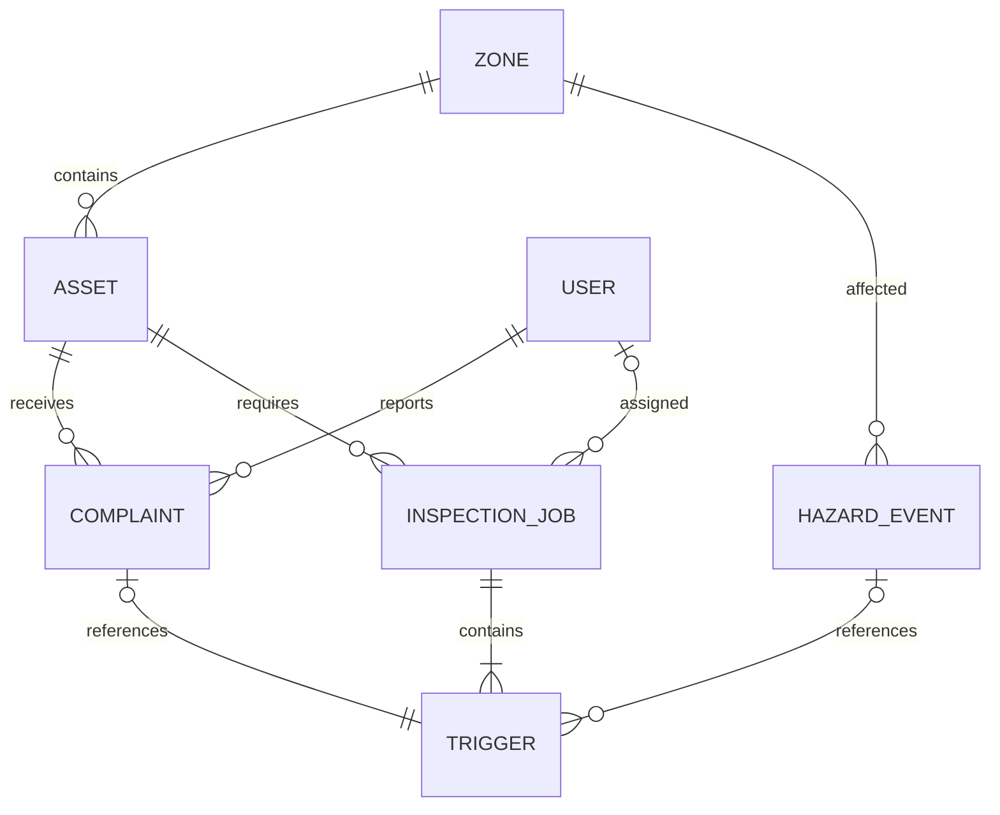

# Data Models and Storage — Green Assets

Status: proposed model. The MVP stores one JSON snapshot in localStorage; there is no SQL database. This file is the canonical source for entity names, fields, and statuses.

A snapshot means the entire current dataset in one object. Its saved JSON restores the app after refresh; it is not an image or a sequence of backups. See [the snapshot explanation in ARCHITECTURE.md](ARCHITECTURE.md#what-a-snapshot-means) for the load/change/save logic.

## Canonical TypeScript types

```ts
type Id = string;
type LocalDate = string; // Valid YYYY-MM-DD, using demo browser's local date.
type Timestamp = string; // ISO 8601 UTC timestamp.
type Condition = "unknown" | "healthy" | "needs_attention" | "critical";
type AssetType = "farm" | "pond" | "solar_system";

interface User {
  id: Id;
  name: string;
  role: "community" | "admin";
}

interface Zone {
  id: Id;
  name: string;
  bounds: { south: number; west: number; north: number; east: number };
}

interface Asset {
  id: Id;
  name: string;
  type: AssetType;
  latitude: number;
  longitude: number;
  zoneId: Id;
  condition: Condition;
  inspectionIntervalDays: number;
  nextInspectionDue: LocalDate;
  lastInspectedAt: Timestamp | null;
  createdAt: Timestamp;
}

interface Complaint {
  id: Id;
  assetId: Id;
  reporterId: Id;
  description: string;
  status: "open" | "reviewed_action_needed" | "resolved";
  createdAt: Timestamp;
}

type Trigger =
  | { kind: "complaint"; complaintId: Id; key: string }
  | { kind: "due"; dueDate: LocalDate; key: string }
  | { kind: "hazard"; hazardEventId: Id; key: string };

interface Checklist {
  version: number;
  questions: { id: string; label: string }[];
}

interface InspectionJob {
  id: Id;
  assetId: Id;
  triggers: Trigger[];
  priority: "low" | "medium" | "high";
  status: "available" | "assigned" | "completed";
  assigneeId: Id | null;
  createdAt: Timestamp;
  claimedAt: Timestamp | null;
  completedAt: Timestamp | null;
  checklist: Checklist; // Copy of template at job creation, not a live reference.
  inspection: {
    answers: Record<string, "pass" | "fail" | "not_applicable">;
    condition: Exclude<Condition, "unknown">;
    notes: string;
    resolvedComplaintIds: Id[];
  } | null;
}

interface HazardEvent {
  id: Id;
  type: "rainfall" | "flooding";
  zoneId: Id;
  affectedAssetIds: Id[];
  simulated: true;
  createdAt: Timestamp;
}

interface Snapshot {
  schemaVersion: 1;
  users: User[];
  zones: Zone[];
  assets: Asset[];
  complaints: Complaint[];
  jobs: InspectionJob[];
  hazardEvents: HazardEvent[];
}
```

## Relationships



Trigger is embedded in jobs, not a separate stored collection. Each complaint/hazard trigger references one source; a due trigger carries its date. A job contains at least one trigger. The repository enforces references because localStorage has no foreign-key enforcement.

## Invariants

- IDs are unique within each collection. Generate new IDs with `crypto.randomUUID()`; use stable IDs in seeds.
- An available job has null assignee, claimedAt, completedAt, and inspection. Assigned jobs have assignee/claimedAt but no completedAt/inspection. Completed jobs retain the assignee and have both completedAt and inspection.
- Trigger keys are unique across all job history, including completed jobs. A complaint belongs to exactly one job through its trigger.
- At most one available job per asset. Several assigned jobs are possible because new reasons do not change an existing assignee's scope.
- Inspection answers match the saved checklist exactly; keep completed results immutable.
- A healthy completion cannot contain failed checks. Resolve only explicitly selected linked complaints; inspection completion alone does not prove repair.
- All listed IDs must reference existing records. Deletion is outside the MVP.

## Due dates

Due means `nextInspectionDue <= today`, even if asset condition is healthy. For a completed job, set lastInspectedAt to its completion timestamp. Advance nextInspectionDue only if the job contains a due trigger matching the asset's current nextInspectionDue; set it to completion's browser-local date plus inspectionIntervalDays. A complaint-only inspection does not change the schedule. Date arithmetic uses calendar days rather than adding 24-hour milliseconds across daylight-saving changes.

## Persistence and seed policy

Storage key: `green-assets:demo:v1`. Save the entire snapshot with one `setItem` after validation. Keep selected demo identity in provider state; refresh and reset select `user-a`.

On missing data, seed four assets of each type, two community users (`user-a`, `user-b`), one admin (`admin-1`), and three fictional zones. Place assets inside their displayed zone bounds; require this for new/edit locations too. Use relative due dates (past, today, future) so the scenario remains useful later. Generate three-to-five-question templates per asset type.

On invalid JSON/schema, return `DATA_INVALID`; on an unsupported schemaVersion, return `DATA_VERSION_UNSUPPORTED`. Do not overwrite existing data automatically. Offer an explicit Reset demo action. Catch storage access/quota failures as `STORAGE_UNAVAILABLE` and display an actionable message.

Reset overwrites only this application's storage key. No real personal data, credentials, or uploaded images belong in the snapshot. Separate browsers/origins have separate datasets. Concurrent tabs are outside the demo's supported editing model.

